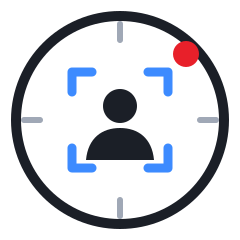

<p align="center">
  <picture>
    <source media="(prefers-color-scheme: dark)" srcset="./docs/assets/logo-mark-dark.svg">
    <source media="(prefers-color-scheme: light)" srcset="./docs/assets/logo-mark-light.svg">
    
  </picture>
</p>

<h1 align="center">PTZ Tracker</h1>

<p align="center">
  <strong>Автоматическое ведение докладчика PTZ-камерой Panasonic AW-HE42.</strong>
</p>

<p align="center">
  <a href="https://github.com/funpin/ptz-tracker/actions/workflows/windows-build.yml"></a>
  
  
  
  
  <a href="LICENSE"></a>
</p>

---

PTZ Tracker находит людей на видео с камеры, оператор кликом выбирает докладчика, и камера сама плавно поворачивается и зумирует, удерживая его в выбранном кадре. Любое ручное действие или Esc мгновенно возвращают камеру оператору.

Как устроено:

- **Камера.** Команды Panasonic по HTTP через очередь с приоритетами: аварийный стоп никогда не теряется.
- **Видео.** MJPEG/RTSP через PyAV. Для слежения нужен MJPEG: от команды до движения в кадре у него 344 мс, у H.264 — ~830 мс.
- **Распознавание.** YOLO11n-pose в ONNX Runtime: DirectML на Windows, CoreML на Mac, при сбое — процессор. Сопровождение цели — по образцу ByteTrack.
- **Регулятор.** Учитывает задержку видео и инерцию камеры, держит мёртвую и мягкую зоны и ограничивает ускорение. Отдельный сторож останавливает камеру, если её раскачивает.
- **Чёрный ящик.** Программа помнит последние 5 минут работы, F9 сохраняет их в zip. Эпизод повторяется без камеры — через регулятор и через распознавание.
- **Симулятор.** Виртуальная AW-HE42 с той же HTTP-командой и динамикой по замерам живой камеры — на ней проверяется всё.
- **Tally ATEM.** Рамка PGM/PVW вокруг видео; только показывает эфир.
- **Агент.** Локальный API (`127.0.0.1`) и команды `--lab` для Claude Code. Двигать камеру агент может только с двумя флажками оператора.

## Быстрый старт

**Windows (оператор).** Скачайте архив `PTZTracker-win64` во вкладке [Actions](https://github.com/funpin/ptz-tracker/actions/workflows/windows-build.yml) (или соберите его сами через `build.bat`), распакуйте и запустите `PTZTracker.exe`. Пошагово: [руководство оператора](docs/OPERATOR.md).

**macOS.** Двойной щелчок по `run_mac.command` — скрипт сам создаст окружение.

**Разработка** (Python 3.12–3.13):

```bash
python3 -m venv .venv && .venv/bin/pip install -e ".[dev]"
.venv/bin/python -m ptztracker --sim        # окно с виртуальной камерой
.venv/bin/python -m ptztracker --replay запись.zip --view   # просмотр эпизода
```

## Проверки

- `.venv/bin/pytest -q -m "not slow"` — быстрый набор (~3 мин): протокол, планировщик, модели, регулятор в виртуальном времени, окна на offscreen-Qt;
- `.venv/bin/pytest -q` — полный набор (~15 мин): замкнутый контур, слежение и калибровка на симуляторе в реальном времени;
- `.venv/bin/ruff check src tests`.

CI на Windows прогоняет линтер и быстрый набор и собирает `.exe` (PyInstaller, onedir).

## Документация

- [руководство оператора](docs/OPERATOR.md);
- [архитектура и инварианты безопасности](docs/ARCHITECTURE.md);
- [решения и замеры, на которых они стоят](docs/DECISIONS.md);
- [бэклог и открытые вопросы](docs/BACKLOG.md);
- [исходный дизайн и факты живой камеры](docs/superpowers/specs/2026-10-19-ptz-tracker-design.md);
- [планы этапов](docs/superpowers/plans/);
- [правила для агента](AGENTS.md) и [правила участия](CONTRIBUTING.md).

## Лицензия

PTZ Tracker распространяется под [GNU AGPL-3.0](LICENSE). Вы можете свободно использовать, изучать, менять и распространять программу, если ваши изменения и производные работы — в том числе доступные пользователям по сети — тоже открыты под AGPL-3.0.

В программу входит модель распознавания YOLO11n-pose ([Ultralytics](https://github.com/ultralytics/ultralytics), AGPL-3.0) — `src/ptztracker/models/yolo11n-pose.onnx`. Если нужна другая лицензия, модель можно заменить моделью под Apache-2.0 (RTMO / RTMDet + RTMPose): меняется только `vision/pose_detector.py`.

© 2026 funpin
