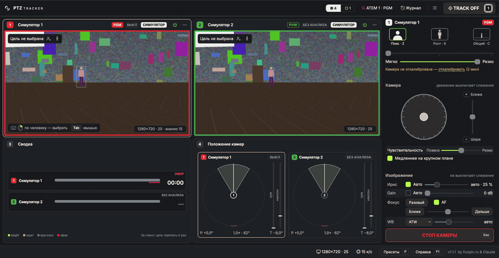
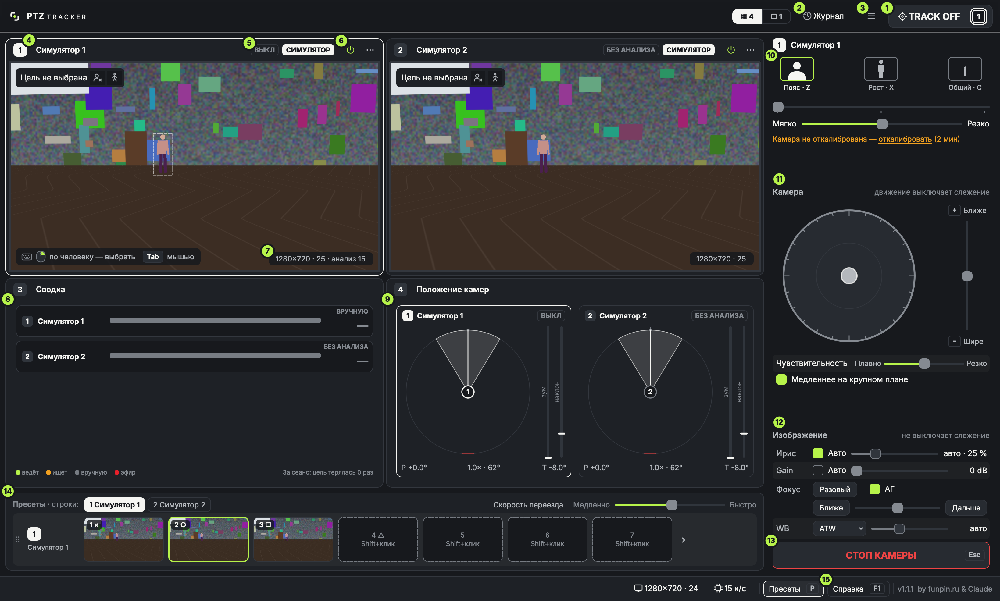
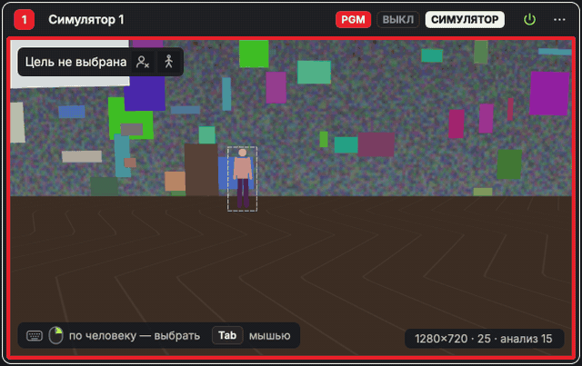
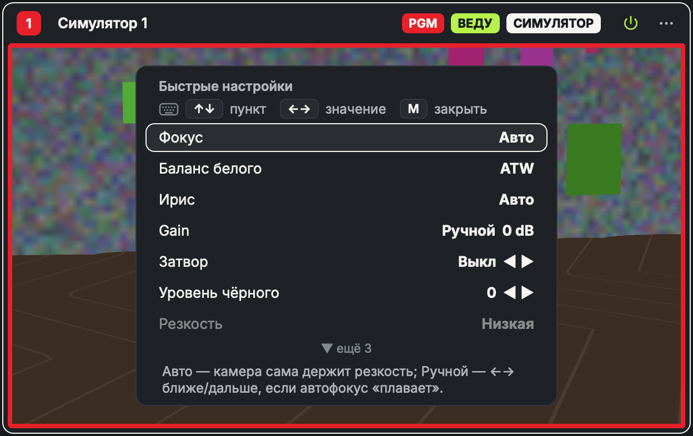
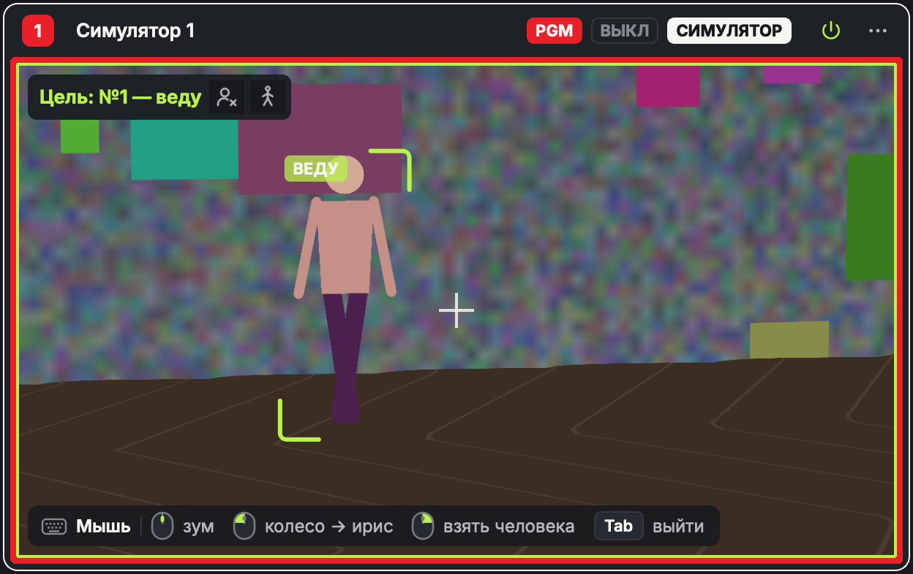
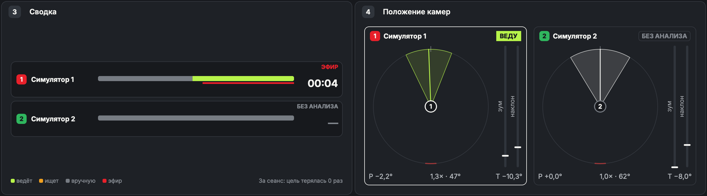
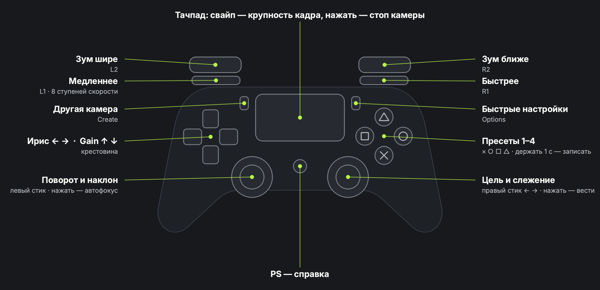

<p align="center">
  <picture>
    <source media="(prefers-color-scheme: dark)" srcset="./docs/assets/logo-lockup-dark.svg">
    <source media="(prefers-color-scheme: light)" srcset="./docs/assets/logo-lockup-light.svg">
    
  </picture>
</p>

<p align="center">
  <strong>Камера сама ведёт докладчика. Оператор — в любой момент главный.</strong><br>
  До четырёх PTZ-камер Panasonic AW-HE42 в одном окне: слежение, геймпады, пресеты, эфир от ATEM.
</p>

<p align="center">
  <a href="https://github.com/funpin/ptz-tracker/releases/latest"></a>
  <a href="https://github.com/funpin/ptz-tracker/actions/workflows/windows-build.yml"></a>
  
  <a href="LICENSE"></a>
</p>

<p align="center">
  <a href="https://github.com/funpin/ptz-tracker/releases/latest"><b>Скачать</b></a> ·
  <a href="docs/OPERATOR.md"><b>Руководство оператора</b></a> ·
  <a href="CHANGELOG.md">Что нового</a>
</p>

<p align="center"></p>

<details>
<summary><b>Что где в окне</b> — картинка с номерами</summary>



1. **TRACK** — слежение выбранной камеры (Пробел); квадратики — все камеры с анализом.
2. **Журнал** — F9 сохраняет последние минуты работы для разбора.
3. **Меню ☰** — камеры, геймпады, ATEM, агент, обновления.
4. **Шапка камеры** — номер (цветом эфира) и выбор камеры.
5. **Состояние** — PGM/PVW, ВЕДУ, ИЩУ, ВЫКЛ, БЕЗ АНАЛИЗА (клик — анализ сюда).
6. **⏻ и ⋯** — режим ожидания, поток, калибровка, диагностика; значки геймпадов с зарядом.
7. **Видео** — разрешение, кадры, скорость анализа; внизу — подсказка, что нажать.
8. **Сводка** — все камеры одной строкой.
9. **Положение камер** — куда смотрит каждая и насколько крупно.
10. **Кадр** — пояс, рост, общий (Z, X, C) и «Мягко ↔ Резко».
11. **Ручное управление** — стик, зум, чувствительность.
12. **Изображение** — ирис, gain, фокус, баланс белого.
13. **СТОП КАМЕРЫ** — Esc, все камеры сразу.
14. **Пресеты** — снимки кадров (P); 1–9 — вызвать, Shift + цифра — записать.
15. **Справка** — F1 или PS на геймпаде.

</details>

## Что умеет

| | |
|---|---|
| **Слежение** | Кликните по человеку и нажмите Пробел — камера плавно держит его в кадре: пояс, рост или общий. Зону кадра можно двигать и растягивать мышью прямо на видео. |
| **До 4 камер** | Сетка 2×2 или одна камера крупно. У каждой — своё слежение, свои пресеты и настройки. Анализ стоит на тех камерах, которые выбрали вы. |
| **Геймпады** | До четырёх DualSense, у каждого своя камера. Стики с настраиваемой кривой, 8 ступеней скорости на L1/R1, пресеты, свайп по тачпаду меняет крупность. |
| **Клавиатура и мышь** | Стрелки или WASD (Shift — быстрее), + / − — зум. Режим «камера как курсор» (Tab): ведёте мышь — едет камера, колесо — зум. |
| **Пресеты со снимками** | Видно, какой кадр вызываете; скорость переезда — одним ползунком. |
| **Эфир** | Tally от ATEM: камера в PGM — красная рамка и номер, в PVW — зелёные. |
| **Безопасность** | Любое ручное действие сразу забирает камеру у автомата. Esc останавливает все камеры. |
| **Разбор полётов** | F9 сохраняет последние 5 минут в zip, окно «Повтор» прокручивает их по кадрам. |
| **Агент** | Локальный API для Claude Code: двигать камеру можно только с двумя флажками оператора. |

<table>
  <tr>
    <td width="50%"><br><sub><b>Слежение</b> — лаймовые уголки на цели, зону кадра тянут мышью</sub></td>
    <td width="50%"><br><sub><b>Быстрые настройки</b> (M) — фокус, баланс, ирис, затвор; в эфир не попадают</sub></td>
  </tr>
  <tr>
    <td width="50%"><br><sub><b>Камера как курсор</b> (Tab) — ведёте мышь, едет камера</sub></td>
    <td width="50%"><br><sub><b>Сводка и положение камер</b> — все камеры на одном экране</sub></td>
  </tr>
</table>

Больше картинок — в [руководстве оператора](docs/OPERATOR.md).

## Управление

<p align="center"></p>

| | Клавиатура и мышь | Геймпад |
|---|---|---|
| Поворот и наклон | стрелки / WASD, Shift — быстрее | левый стик |
| Зум | + / − | L2 / R2 |
| Выбрать человека | клик по нему | правый стик ← → |
| Вести / отпустить | Пробел | нажать правый стик |
| Крупность кадра | Z · X · C | свайп по тачпаду |
| Пресет | 1–9, Shift + цифра — записать | ✕ ○ □ △, держать — записать |
| Ирис и gain | в правой колонке | крестовина |
| Другая камера | клик по клетке | Create |
| Быстрые настройки | M | Options |
| Стоп | Esc — все камеры | нажать тачпад — своя камера |

Подсказка внизу видео показывает кнопки того, чем вы управляете сейчас; полная справка с рисунками — F1.

## Быстрый старт

1. Скачайте сборку со страницы [последнего релиза](https://github.com/funpin/ptz-tracker/releases/latest): **Windows** — установщик или portable-zip, **macOS (Apple Silicon)** — DMG. При обновлении настройки сохраняются.
2. ☰ → «Камеры» → добавьте камеру по IP; один раз запустите калибровку (2 минуты, камера не должна быть в эфире).
3. Кликните по докладчику, нажмите Пробел.

Без камеры можно потренироваться на встроенном симуляторе: `python -m ptztracker --sim`.

<details>
<summary><b>Как устроено</b></summary>

- **Камера** — команды Panasonic по HTTP через очередь с приоритетами: аварийный стоп никогда не теряется.
- **Видео** — MJPEG/RTSP через PyAV; для слежения нужен MJPEG (задержка 344 мс против ~830 мс у H.264).
- **Распознавание** — YOLO11n-pose в ONNX Runtime: DirectML на Windows, CoreML на Mac, при сбое — процессор.
- **Регулятор** — учитывает задержку видео и инерцию камеры, держит мёртвую и мягкую зоны; сторож останавливает раскачку.
- **Симулятор** — виртуальная AW-HE42 с динамикой по замерам живой камеры; на ней проверяется всё.

Подробно — в [архитектуре](docs/ARCHITECTURE.md) и [решениях с замерами](docs/DECISIONS.md).
</details>

<details>
<summary><b>Разработка</b></summary>

Python 3.12–3.13:

```bash
python3 -m venv .venv && .venv/bin/pip install -e ".[dev]"
.venv/bin/python -m ptztracker --sim                        # окно с виртуальными камерами
.venv/bin/python -m ptztracker --replay запись.zip --view   # повтор эпизода
.venv/bin/pytest -q -m "not slow" && .venv/bin/ruff check src tests
```

`.exe` собирает `build.bat` или CI на Windows. Внешний вид — по [брендбуку](docs/BRANDBOOK.md); картинку окна пересобирает `python scripts/make_overview.py`, картинки руководства — `python scripts/shoot_guide.py`, анимации — `python scripts/make_animation.py`, схему геймпада — `python scripts/make_pad_map.py`. Ещё: [бэклог](docs/BACKLOG.md), [релизы](docs/RELEASING.md), [правила для агента](AGENTS.md), [участие](CONTRIBUTING.md).
</details>

## Лицензия

[GNU AGPL-3.0](LICENSE): пользуйтесь, меняйте и распространяйте свободно, если ваши изменения тоже открыты. В программу входит модель YOLO11n-pose ([Ultralytics](https://github.com/ultralytics/ultralytics), AGPL-3.0); её можно заменить моделью под Apache-2.0 — меняется только `vision/pose_detector.py`.

© 2026 funpin
